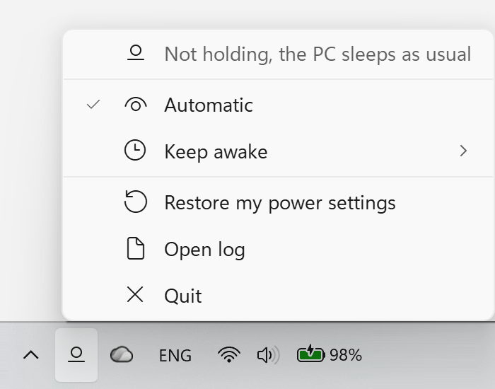
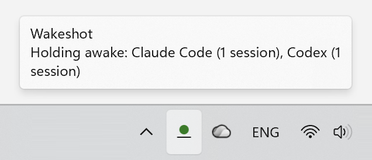
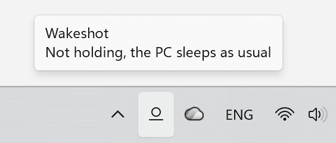

<h1 align="center">
  <picture>
    <source media="(prefers-color-scheme: dark)" srcset="site/wakeshot-lockup-dark.svg">
    
  </picture>
</h1>

**Wakeshot keeps your Windows PC awake while something needs it, then lets it sleep as usual.**

An AI agent at work, a long build or any other command, or Keep awake from the tray menu: while one of them runs, the
PC stays awake, even with the laptop lid closed. When the work is done, your own power settings come back. A small,
lightweight tray app: no window to learn, nothing else to install. Free and open source (MIT).

<!-- Haik: paste the video URL here. Upload the final promo MP4 (where it is: media/README.md) to GitHub, by dragging it into a comment box on github.com or with `gh issue comment <n> --attach`. Then replace this whole comment with the bare https://github.com/user-attachments/assets/<id> URL on its own line, with a blank line above and below, so GitHub shows a player. Link nothing else for the video. -->

## Install

> [!NOTE]
> Not released yet. The first release and the winget package are on the way; until then there is nothing to install.

<!-- release: drop this note once the first release is out and winget has the package. -->

For Windows 11, x64 and ARM64. It installs for your user only and never asks for admin rights.

```powershell
winget install HaikAsatryan.Wakeshot
```

<!-- winget: check that this command installs Wakeshot once HaikAsatryan.Wakeshot is merged in winget-pkgs. -->

Then start Wakeshot once from the Start menu. From then on it starts by itself each time you sign in.

Or download the Setup from [Releases](https://github.com/HaikAsatryan/wakeshot/releases) and run it:
`HaikAsatryan.Wakeshot-win-x64-Setup.exe`, or `HaikAsatryan.Wakeshot-win-arm64-Setup.exe` for Windows on Arm. It
starts Wakeshot right away.

<details>
<summary>What the install sets up, the SmartScreen warning, and updates</summary>

- **winget** picks the Setup for your PC, x64 or ARM64, and runs it silently. That is why Wakeshot first
  starts from the Start menu or at your next sign-in.
- **On first start**, a notice, "Wakeshot is running", says that its icon may hide under the `^` arrow on the
  taskbar. To keep it in view, click the notice, then turn on Wakeshot under "Other system tray icons".
- **What the install sets up:**
  - the app in `%LocalAppData%\HaikAsatryan.Wakeshot`, and a Start menu shortcut (no desktop shortcut);
  - start at login, a `Run` value under your user's registry;
  - the `wakeshot` command on your user `Path` (open a new terminal to use it);
  - its own data in `%LocalAppData%\Wakeshot`, kept apart from the app, so updates and reinstalls never touch it.
- **Not signed yet.** v1 is not code-signed, so Windows SmartScreen may warn you before Setup runs.
  <!-- todo: the exact SmartScreen words and the steps to go on are not in docs/research.md yet; add them from a capture of the first public pre-release (v0.1.0-rc.1). -->
  Signing comes through SignPath Foundation's free program once Wakeshot has users; signed builds then show
  "SignPath Foundation" as the publisher.
- **Updates.** Wakeshot updates itself, also when winget installed it, so `winget upgrade --all` skips it. More in
  [Updates and privacy](#updates-and-privacy).

</details>

## What keeps your PC awake

Wakeshot calls each reason to stay awake a hold. While any hold runs, the PC stays awake. When the last one ends, the
PC sleeps as usual, and your settings are your own again. Today these can hold:

| What | The PC stays awake while |
|---|---|
| **AI agents**: <!-- agents -->Claude Code, Codex CLI, Copilot CLI, Copilot in VS Code and OpenCode<!-- /agents --> | an agent works on your task, or runs work it started in the background. Each one was tested live. Wakeshot reads the small files each agent keeps and never changes an agent's settings |
| **Any command**: `wakeshot run -- <command>` | that command runs: a build, a test suite, a backup, a download |
| **Any script**: a [hold file](docs/hold-files.md) | the process named in the file runs |
| **You**: Keep awake in the menu | the time you picked runs: 30 minutes, 1, 2 or 4 hours, or until you turn it off |

The list grows with each version. Wakeshot supports an agent only where it can see exactly when the work ends, so
Cursor, Antigravity and VS Code's own Local chats are not on it yet ([why](#limits)). **Automatic**, on by default,
is the switch for the first three; Keep awake works either way. The exact rules:
[When each hold counts](#when-each-hold-counts).

## How it works

A night with Wakeshot:

1. **You start a long job and walk away**, such as an agent's task or a build. The tray icon's light comes on. Your
   screen still turns off on its usual timer; only sleep waits.
2. **You close the lid.** A short chime says the laptop keeps running, and Wakeshot locks it, so a closed laptop
   never runs unlocked.
3. **The job ends in the night.** Wakeshot puts your lid and sleep settings back at once. After 5 minutes with no
   input it plays a soft "going to sleep" sound and puts the laptop to sleep.
4. **Morning.** You open the lid and sign in. A notice says how long the PC ran with the lid closed, and what kept it
   running.
5. **The battery ran low instead?** Below Windows' own energy saver level, Wakeshot steps back, puts your settings
   back and puts the closed laptop to sleep after 5 minutes with no input.

When nothing holds, Wakeshot changes nothing: your PC behaves as if Wakeshot were not there.

## What you see

<p align="center">
  <picture>
    <source media="(prefers-color-scheme: dark)" srcset="media/out/icon-loop-dark.gif">
    
  </picture>
</p>

The icon tells you what is going on, and its tooltip names what holds the PC awake:

| Icon | State | The tooltip says | What it means |
|---|---|---|---|
| <picture><source media="(prefers-color-scheme: dark)" srcset="media/out/state-holding-dark.png"></picture> | Holding | `Holding awake: Codex (1 session)` | Something needs the PC. It stays awake, and closing the lid does not stop it. |
| <picture><source media="(prefers-color-scheme: dark)" srcset="media/out/state-idle-dark.png"></picture> | Idle | `Not holding, the PC sleeps as usual` | Automatic is on, and nothing needs the PC right now. |
| <picture><source media="(prefers-color-scheme: dark)" srcset="media/out/state-off-dark.png"></picture> | Off | `Automatic is off, the PC sleeps as usual` | Wakeshot watches nothing. Keep awake still works. |

Click the icon for the menu:

<p align="center">
  <picture>
    <source media="(prefers-color-scheme: dark)" srcset="media/public/shots/readme-menu-dark.png">
    
  </picture>
</p>

<p align="center">
  <picture>
    <source media="(prefers-color-scheme: dark)" srcset="media/public/shots/readme-holding-tooltip-dark.png">
    
  </picture>
  <picture>
    <source media="(prefers-color-scheme: dark)" srcset="media/public/shots/readme-idle-tooltip-dark.png">
    
  </picture>
</p>

## How it compares

PowerToys Awake, Caffeine and Don't Sleep are the most popular keep-awake tools for Windows that we could count. All
three keep the PC awake while you tell them to, and so does Wakeshot. The rows in bold are what only Wakeshot does.

| | Wakeshot | [PowerToys Awake](https://learn.microsoft.com/en-us/windows/powertoys/awake) | [Caffeine](https://www.zhornsoftware.co.uk/caffeine/) | [Don't Sleep](https://www.softwareok.com/?seite=Microsoft/DontSleep) |
|---|---|---|---|---|
| Keep the PC awake for a set time, or until you turn it off | yes | yes | yes | yes |
| **Stay awake on its own while an AI agent works, then sleep as usual** | yes | no | no | no |
| Stay awake while a build or a script runs | yes | until a process you name ends (command line) | while a window with a given title is open, or until CPU use drops | until CPU or network use drops |
| **Keep a laptop working with the lid closed** | yes, and locks it | no | no | no |
| **Still lock the PC when you walk away** | yes | not listed; its docs say to lock the PC yourself | no, by default: its fake key presses stop the lock | not listed |

Read on each tool's own pages on 2026-11-04, and PowerToys Awake again on 2026-11-06. The source of every cell:
[launch research](docs/research/launch.md#1-rivals-for-the-readme-table). Why none of them keeps a closed laptop
working: no keep-awake request can stop a lid close, only the lid setting can
([Windows power facts](docs/research.md#windows-power-facts)), and none of the three changes it.

The Claude desktop app has a
[Keep computer awake](https://code.claude.com/docs/en/desktop-scheduled-tasks#how-scheduled-tasks-run) setting too. It
holds for that app's own sessions, not for Claude Code in a terminal, other agents or other programs, and its docs
say that closing the lid still puts the laptop to sleep.

Where the others lead: years of use and many users. They run on Windows 10 too, and Caffeine and Don't Sleep are tiny
downloads. Don't Sleep can also block a shutdown and shut the PC down on a schedule. Wakeshot is new, runs on Windows
11 only and knows only the agents listed above.

## Why I built it

Before Wakeshot, I used PowerToys Awake when an agent worked for hours or a big download ran. I installed all of
PowerToys, a download of over 300 MB, for that one feature. In its tray menu the longest set time is 2 hours. Longer
ones are there too, but in PowerToys Settings or a JSON file, and for me that was a step too many. Now and then I also
ran into its bugs. Other tools I tried had gaps of their own. The Claude desktop app's own setting does not keep a
closed laptop working, and Claude Code in a Windows terminal does not keep the PC awake at all.

So I ended up changing my laptop's power settings by hand for long sessions, and more of them when I had to close the
lid. Small stresses, again and again, but nothing critical. The critical part came when I forgot to change them back:
a laptop running hot in my bag, or a dead battery right when I needed it.

That is why I built the tool I wanted, first of all for myself. It does a simple, almost trivial thing. Under the
hood it is not simple: the lid, the battery, a dock, the lock, sleep, a crash, sign-out and updates each bring their
own cases. I tried to get each one right, down to every notice and every sound. I hope it helps you too.

(What this says about other tools is checked in
[docs/research.md](docs/research.md#story-checks-powertoys-awake-and-claudes-own-keep-awake).)

### What comes next

More agents and more reasons to stay awake will come.

Wakeshot runs on Windows only, because I built it for myself and I use Windows. Its design is ready for other systems:
the part that decides when to hold has no Windows code, so a port adds only the parts that talk to the system. A macOS
version will come if Wakeshot gets popular or gets donations. It is a long job for a Windows person, since so much
leans on each system's own power rules, and I would need a Mac to build and test on. Linux is not planned now: with
its many desktops (GNOME, KDE and more), distributions and package managers, it would be a project of its own.

If you want to build something yourself, pull requests are welcome; I review each one's architecture. Start with
[CONTRIBUTING.md](CONTRIBUTING.md). Security problems: [SECURITY.md](SECURITY.md). How we treat each other:
[CODE_OF_CONDUCT.md](CODE_OF_CONDUCT.md).

## Details

Everything else, folded. Open what you need.

- [When each hold counts](#when-each-hold-counts)
- [What it changes on your PC](#what-it-changes-on-your-pc)
- [Lid closed, lock and battery](#lid-closed-lock-and-battery)
- [The menu, notices and start at login](#the-menu-notices-and-start-at-login)
- [Commands](#commands)
- [Updates and privacy](#updates-and-privacy)
- [Limits](#limits)
- [Uninstall](#uninstall)

### When each hold counts

<details>
<summary>AI agents, <code>wakeshot run</code>, hold files and Keep awake, exactly</summary>

**Claude Code.** Wakeshot reads the small status file Claude Code keeps for each session (in `~/.claude/sessions`),
and that session's transcript for timers and background tasks. It reads only the fields it needs, never stores or
logs your prompts, adds no hooks and never edits Claude's settings. A session holds:

- while it works, also while background subagents run after a turn;
- while a background command runs and the session is idle, for as long as the session lives;
- in VS Code, the SDK or the Desktop app, while a background task in the transcript is still open;
- while a scheduled run (`/loop`, a cron job, a wakeup) is due within 1 hour;
- while it waits for your answer, but only with Remote Control on, and at most 1 hour.

A session counts only while its process lives, so a crashed session or a file left behind never holds. If Claude
Code changes its files and Wakeshot cannot read them, a notice says "Update Wakeshot". Tested live with Claude Code
2.1.317, in the terminal and through the SDK ([results](docs/research/claude-code-signals.md#end-to-end-2026-11-04)).

**Codex CLI.** Wakeshot lists the lock files Codex CLI keeps for each open thread (in `.codex` of your user folder,
or the folder `CODEX_HOME` names) and reads that thread's session log for its turns. It reads only the fields it
needs, never stores or logs your prompts, adds no hooks and never edits Codex's settings. A thread holds while a
turn runs, also while Codex waits for your approval (it writes nothing while it waits, so the wait looks like work),
and only while the `codex.exe` that holds the thread lives, so a crash ends the hold. Tested live with Codex CLI
0.167.0, in the terminal and with `codex exec` ([results](docs/research/other-agent-signals.md#codex-live-test-2026-11-06)).

**Copilot CLI.** Wakeshot lists the in-use files Copilot CLI keeps in each session's folder (in `.copilot` of your
user folder, or the folder `COPILOT_HOME` names) and reads that session's event log for its turns. It reads only the
fields it needs, never stores or logs your prompts, adds no hooks and never edits Copilot's settings. A session holds
while a turn runs, and while a scheduled prompt (`/every`) is due within 1 hour; and only while the process that has
the session open lives, so a crash ends the hold. While Copilot waits for your approval or your answer, it does not
hold. Tested live with Copilot CLI 1.0.106, in the terminal and with `copilot -p`
([results](docs/research/other-agent-signals.md#copilot-cli-live-test-2026-11-06)).

**Copilot in VS Code.** Chats that run on the Copilot harness (VS Code's setting `chat.defaultToCopilotHarness`) are
Copilot CLI sessions of VS Code's own `copilot-runtime.exe`, so the Copilot CLI rules above apply to them. The hold
ends at the turn's end or at Stop, and only while that `copilot-runtime.exe` lives. Close the window while such a chat
works, and the agent goes on, so the hold lasts until the turn really ends. VS Code's own Local chats do not hold
([why](#limits)). Tested live with VS Code 1.145.1 and its Copilot extension 0.73.0: a turn, Stop, approval allowed
and skipped, and a window closed mid-turn ([results](docs/research/copilot-vscode-signals.md#stop-approve-and-window-close-live-test-2026-11-06)).

**OpenCode.** For OpenCode 2.x, Wakeshot opens its database (`opencode\opencode.db` in `.local\share` of your user
folder, or in the folder `XDG_DATA_HOME` names) read only, through Windows' own SQLite, and reads only the session and
schedule tables. The same file holds OpenCode's login; no query touches those tables, and nothing from the file goes
to the log. A session holds while it works on a turn, also while OpenCode waits for your approval (it keeps that wait
only in memory, so the wait looks like work), and while a schedule is due within 1 hour; and only while an OpenCode
process that was running when the turn started lives, so a crash ends the hold. Wakeshot looks for changes every 2
seconds, so a turn shorter than that may not hold. OpenCode 1.x is not read. Tested live with OpenCode 2.2.5, in the
terminal and with `opencode run` ([results](docs/research/opencode-signals.md#live-test-2026-11-06)).

**`wakeshot run -- <command>`.** Holds while that command runs: a build, a test suite, a backup, anything. Such as
`wakeshot run -- npm test`. The command always runs, gets its arguments exactly as typed and keeps its exit code.

**Hold files.** Any script can hold the PC awake by writing a small JSON file to `%LocalAppData%\Wakeshot\holds\`.
The hold lasts while the process named in it runs. Format and examples: [docs/hold-files.md](docs/hold-files.md).

**Keep awake.** From the menu or `wakeshot keep-awake`: 30 minutes, 1 hour, 2 hours, 4 hours, or until you turn it
off, with Keep screen on if you want it. It works whether Automatic is on or off, and the lid and battery rules below
apply to it the same way. It ends at sign-out or restart, so a forgotten "Until I turn it off" never survives a
reboot.

**Automatic** (on by default) is the switch for the agents, `wakeshot run` and hold files. Off: only Keep awake
holds.

</details>

### What it changes on your PC

<details>
<summary>One power request, a few power settings, and how your own values come back</summary>

When nothing holds, Wakeshot changes nothing: your PC behaves as if Wakeshot were not there.

While something holds:

1. **A power request.** Wakeshot asks Windows to keep the system running. The screen still turns off on its usual
   timer, unless you turn on Keep screen on.
2. **Three settings of your active power plan**, written when the hold starts and put back when it ends:

| Setting | While holding | Why |
|---|---|---|
| Lid close, plugged in | Do nothing | No power request can stop a lid close; only this setting keeps a closed laptop working |
| Lid close, on battery | Do nothing | The same |
| Sleep after, on battery | Never | On battery, Windows ends every power request about 5 minutes after this timeout, lid open or closed |

The facts and our tests behind the table: [Windows power facts](docs/research.md#windows-power-facts). Wakeshot writes
them also when plugged in, so unplugging, or a USB-C dock that drops power for a few seconds, never meets the battery
rule first. During a hold, sleep while plugged in is never touched: there a power request is enough. While a hold
runs, Windows Settings shows these values; that is Wakeshot, and they go back when the hold ends.

**After work ends with the lid closed**, Wakeshot puts the laptop to sleep, where Windows would have put it. Apps
cannot start sleep on a Modern Standby laptop (most laptops of the last years), so Wakeshot sets the screen and sleep
timeouts of the plan in use to 1 minute where yours are longer, and Windows' own idle sleep does the rest. They go
back when you open the lid, when you unlock, at any input, when a new hold starts and at every point below; not when
the laptop only wakes with the lid closed, so it sleeps again.

How your values come back:

- Before any write, Wakeshot saves your value in `%LocalAppData%\Wakeshot\journal.json` and remembers what it wrote.
- It puts back only what is still its own. Change one of these settings during a hold, and your change wins at once:
  Wakeshot leaves that setting alone on every plan until the current work ends, and a notice says so.
- Switch power plans, and it puts the old plan back and applies to the new one.
- It puts them back when the work ends, at Quit, at sign-out, at its next start and at uninstall. If Wakeshot crashes
  or is killed, a small guard process, which runs only while settings are changed, puts them back. If even that does
  not run, your next sign-in does.
- **Restore my power settings** in the menu, or `wakeshot restore`, puts them back now and stops changing them until
  the current work ends. The PC still stays awake for the work, but only while the lid is open.
- If a company policy blocks the change, Wakeshot keeps the PC awake with the power request only, and tells you.
- Every write goes to the log with the old and the new value.

Everything else it keeps, all under your user:

- `%LocalAppData%\Wakeshot`: `config.json` (Automatic on or off), `holds\` (hold files), `state.json` (what Wakeshot
  is doing, for `wakeshot status`), `journal.json` (your saved values, only while settings are changed),
  `restore-request.json` (a short-lived request from `wakeshot restore`), `logs\` (the log).
- Registry, under `HKCU\Software\Microsoft\Windows\CurrentVersion`: `Run\Wakeshot` (start at login) and
  `RunOnce\WakeshotRestore` (only while settings are changed: the restore at your next sign-in). And
  `HKCU\Software\Classes\AppUserModelId\velopack.HaikAsatryan.Wakeshot`: the name and icon in the header of its
  notices.
- Your user `Path`: the app's folder, for the `wakeshot` command.
- Windows itself keeps a record of every tray icon it has seen, Wakeshot's too (`HKCU\Control Panel\NotifyIconSettings`).

Wakeshot changes no other setting, never touches other apps and never needs admin rights.

</details>

### Lid closed, lock and battery

<details>
<summary>Close the lid, unplug, run low: what happens, and why it never lowers your security</summary>

Wakeshot never lowers your security.

- **Close the lid while something holds.** A short chime says the laptop keeps running, and Wakeshot locks the PC.
  Windows would have slept, and with the lid set to Do nothing it would not lock by itself.
- **Docked, with your own lid action already Do nothing.** Wakeshot changes nothing there: no lock, no chime.
- **Unplug a closed laptop that runs only because of Wakeshot.** It locks once the laptop has been on battery for
  30 seconds, so a dock's short power drop does not lock you while you work on the external screen.
- **If the lock fails.** Wakeshot tries once more. If that fails too, it stops holding, puts your settings back and
  puts the laptop to sleep after 5 minutes with no input, so a closed laptop never runs unlocked in a bag. The hold
  comes back once the lid opens or the PC locks.
- **Work ends with the lid closed.** Your settings come back at once. After 5 minutes with no input, a short "going to
  sleep" sound plays and Wakeshot puts the laptop to sleep ([how](#what-it-changes-on-your-pc)). Open the lid during
  the sound to stop it. Typing on an external screen counts as input, so a docked laptop is not put to sleep under
  your hands. If it has not slept 5 minutes later, Wakeshot hibernates it. If hibernate is off or fails, a notice says
  so, and until the lid opens Wakeshot locks it whenever it is idle for 5 minutes.
- **Open the lid and sign in.** A notice says how long the PC ran with the lid closed and what held it, such as "The
  PC kept running for 2 h 15 min with the lid closed. What held it: Codex."
- **Battery floor.** Wakeshot uses Windows' own energy saver level (20% when energy saver is set to Never or Always);
  there is no Wakeshot setting for it. Below it, once the laptop has been on battery for 30 seconds, Wakeshot steps
  back: it ends its power request, puts your settings back, plays a sound and says "Battery low: the PC may sleep
  now". If power comes back within those 30 seconds, as when a dock drops it for a few seconds, nothing happens: no
  sound, no notice. After a step back with the lid closed, it puts the laptop to sleep the same way after 5 minutes
  with no input, unless your own battery lid action is Do nothing. Plug in, and the hold comes back.
- **Keep screen on.** The screen never turns off, so Windows does not lock the PC at screen off; Wakeshot locks it
  instead once you have been away longer than your own sleep timeout.
- **Start > Sleep.** Your own sleep always wins. Windows drops every power request then, and Wakeshot takes its
  request again after you wake the PC.

Sounds: three short ones, for a lid close while holding, for "going to sleep", and for the battery floor. They follow
your Windows sound scheme ("No sounds" means none). They play on your default audio device, unless that is a
screen's audio (HDMI or DisplayPort, often with no speakers); then on the laptop speakers.

</details>

### The menu, notices and start at login

<details>
<summary>Every menu item, every notice, and how to stop Wakeshot starting at login</summary>

Click the tray icon:

```text
Holding awake: Codex (1 session), cargo
---------------------------------------
Automatic                           [x]
Keep awake                           >    Off
---------------------------------------   30 minutes
Restore my power settings                 1 hour
Open log                                  2 hours
Quit                                      4 hours
                                          Until I turn it off
                                          -------------------
                                          Keep screen on
```

- **The top line** says what holds right now, in the same words as the tooltip.
- **Automatic**: watch AI agents, `wakeshot run` and hold files. On by default, and kept across restarts.
- **Keep awake**: hold for a time, or until you turn it off. **Keep screen on** keeps the screen on too, while Keep
  awake is on.
- **Restore my power settings**: put your lid and sleep settings back now (see above).
- **Open log**: opens the log with your default app.
- **Quit**: stop holding, put your settings back, end Keep awake, exit.

The menu follows your taskbar's light or dark mode, like Windows' own tray menus. Other top lines you may see:
`Holding awake, screen on`, `Holding awake, lid open only` (Wakeshot could not change the power settings, so closing
the lid sleeps the laptop as usual), `Battery low, not holding` and `Cannot hold awake` (Windows refused the power
request).

A routine hold that starts or ends shows only in the icon and the tooltip. Anything Wakeshot does on its own gets a
notice:

| Notice | When |
|---|---|
| Wakeshot is running | First start: where the icon is and how to pin it |
| Wakeshot keeps your change | You changed a setting Wakeshot had changed |
| Your power settings are back | You picked Restore my power settings |
| The PC ran with the lid closed | You are back after a closed-lid hold |
| Battery low: the PC may sleep now | The battery is below the floor, and the laptop has been on battery for 30 seconds |
| Wakeshot locked the PC | Keep screen on, and you were away past your sleep timeout |
| Wakeshot updated to (version) | After an update, with no sound |
| Update Wakeshot | An AI agent changed its files, and Wakeshot cannot fully read them |
| Wakeshot cannot change power settings | Something, such as a company policy, blocked the change |
| Wakeshot cannot keep the PC awake | Windows did not accept the power request |
| Could not put back your power settings | A restore failed; Wakeshot keeps trying, and the log has your old values |
| Power settings set to Windows defaults | Wakeshot could not read the file with your saved values, so its own values went to Windows defaults; the log has your old values |
| Check your power settings | The same, but setting Windows defaults failed too: set them by hand |
| Wakeshot could not lock the PC | Windows did not lock; with the lid closed Wakeshot tries once more |
| The PC did not go to sleep | With the lid closed, the PC did not sleep and could not hibernate |

Notices raised while the PC is locked, or while another user is on the screen, wait until you are back. Sounds never
wait.

**Start at login** is on after the install. To turn it off: Settings > Apps > Startup, then switch Wakeshot off.
Uninstall removes it.

</details>

### Commands

<details>
<summary>The <code>wakeshot</code> command, its help and what each command does</summary>

`wakeshot --help`:

```text
Wakeshot keeps this PC awake while something needs it.

Usage: wakeshot <command>

Commands:
  run -- <command>                           Run a command, awake until it ends
  keep-awake 30m|1h|2h|4h|on|off [--screen]  Keep awake for a time, or until off
  automatic on|off                           Watch AI agents and 'run' commands
  status                                     Show what Wakeshot is doing
  restore                                    Restore your power settings
  log                                        Open the log
  diagnostics [folder]                       Save a file for a bug report

'keep-awake on' lasts until you turn it off. '--screen' keeps the screen on too.

Test aid:
  --dry-run   Before the command: use the dry-run data folder, as the tray's
              --dry-run does. Such as: wakeshot --dry-run status
```

- `run`: everything after `--` is your command, exactly as typed, such as `wakeshot run -- npm test`. It runs in the
  same console, and `wakeshot` exits with its exit code. It always runs the command, and warns when Wakeshot is not
  running or Automatic is off. Its own codes, as GNU `env` and `timeout` use them: 127 the command was not found, 126
  it cannot start (a `.ps1` file, for example: run `pwsh -File <script>` instead), 125 it lost the command. The hold
  follows the command's own process, not the `wakeshot` wrapper.
- `keep-awake`: the same lengths as the menu. It needs Wakeshot running, and says so when it is not. `--screen` does
  not go with `off`.
- `automatic on` and `automatic off`: the same as the menu's Automatic.
- `status`: what holds, what is changed, and whether Wakeshot runs at all.
- `restore`: the same as Restore my power settings.
- `log`: opens the log.
- `diagnostics`: saves one text file for a bug report on your Desktop, or in the folder you give, and shows it in
  Explorer. It holds Wakeshot's own files only, with your user name and anything that looks like a token taken out.
- Words match in any case, as in Windows' own commands.

For your own lengths and labels, write a hold file: [docs/hold-files.md](docs/hold-files.md).

</details>

### Updates and privacy

<details>
<summary>Automatic updates between holds, two checks a day, no telemetry, and what it uses</summary>

- Wakeshot updates itself from GitHub Releases. It checks 5 minutes after it starts, then every 12 hours, and
  downloads a new version at once.
- It applies the update only when nothing holds (no agent at work, no `wakeshot run`, no hold file, no Keep awake),
  none of your settings are changed and no closed-lid sleep is pending. So an update never cuts your work short.
- Then Wakeshot quits and the new version starts. One quiet notice says "Wakeshot updated to (version)", with no
  sound.
- A failed check or download waits for the next check, with no notice. Pre-releases are skipped.
- The only network calls are those update checks and downloads, to GitHub, with no account and no token.
- No telemetry. The log stays on your PC: `%LocalAppData%\Wakeshot\logs\wakeshot.log`, plain English, rolled over
  once it passes 1 MB; older files go after 30 days, and all of them together stay under 8 MB. It never holds your
  prompts, transcript text or full command lines; `wakeshot run` keeps only the program's name.
- To report a bug, run `wakeshot diagnostics`. It saves one text file on your Desktop with Wakeshot's own logs and
  settings files, and your user name and anything that looks like a token taken out; nothing is sent. Attach it to a
  [bug report](https://github.com/HaikAsatryan/wakeshot/issues/new?template=bug-report.yml).
- Wakeshot only reads the files each agent keeps. OpenCode's database it opens read only and queries only its session
  and schedule tables, never the ones with OpenCode's login.
- Lightweight: at idle the tray app uses 4 MB of private memory and 141 ms of CPU in 10 minutes (0.023% of one core),
  measured on the v1 build, x64, on 2026-11-07 ([how](docs/research.md#speed-numbers-of-the-shipping-build-2026-11-07)).

</details>

### Limits

<details>
<summary>What v1 does not do, and the rare cases where your settings stay changed for a while</summary>

**After a crash, your settings can stay changed for a while.** In these cases nothing puts them back right away: the
lid action stays Do nothing and battery sleep Never, so closing the lid does not sleep the laptop, and a closed laptop
at the sign-in screen does not sleep either. After work that ended with the lid closed, the screen and sleep
timeouts can stay at 1 minute instead. A restore before sign-in would most likely need a task that runs at boot, and
that needs admin rights, which Wakeshot never asks for.

- Until your next sign-in:
  - Windows crashes, or the power is cut, during a hold;
  - you pick "Shut down anyway", or Windows ends your session, before the restore at sign-out finishes;
  - End task ends Wakeshot and its guard together, if their separate starts do not keep them apart (not tested yet).
- Until Wakeshot next starts (from the Start menu, or at the next sign-in when start at login is on), because Windows
  deletes the one-time sign-in entry before it runs it:
  - a crash, power cut or End task as above, between a sign-in running that entry and Wakeshot setting it again;
  - the restore at sign-in fails for 2 minutes, and the Wakeshot it then starts fails to start too;
  - the restore at sign-in crashes.
- Until you reinstall, with no warning: you uninstall during a hold, and the restore fails for the uninstall's whole
  25 seconds. Your saved values stay, so a reinstall puts them back.

**A lost record of your values goes to Windows defaults.** If Wakeshot cannot read the file with your saved values
for 2 minutes of run time (a damaged file: at once), it sets the file aside. On the plan in use, each setting that
holds exactly the value Wakeshot writes (lid Do nothing, battery sleep Never, and the 1-minute screen and sleep
timeouts after a closed-lid work end) goes to Windows' default for that plan; any other value is yours and stays. A
notice says what was reset, and the log has the old values. So if you had set Do nothing, Never or 1 minute
yourself, set it again (Windows' default battery sleep was 3 minutes on our test laptop). An uninstall that finds a
damaged file does the same reset, with no notice. During those 2 minutes a lid close gets no lock, and with nothing
holding, a closed laptop that a crashed Wakeshot left at Do nothing may run unlocked for up to about 7 minutes before
it sleeps.

**A failed restore brings Wakeshot back.** When the guard or the restore at sign-in cannot put your settings back for
2 minutes, it starts Wakeshot, even with start at login off, so you see the warning and the retries go on. That
Wakeshot also holds for agents as usual, so with start at login off it is back and changes your settings at the next
agent turn. After a Quit whose restore failed, Wakeshot comes back 2 minutes later.

**One signed-in user at a time.** Power plans belong to the whole PC. When another user takes the screen (switch
user), Wakeshot puts your values back and keeps only its power request, then applies them again when you come back.
If one user's changes were left behind (that session ended without a restore), another user's Wakeshot takes Do
nothing for that user's own choice: no lock, no sleep. A second signed-in user's Wakeshot keeps the PC awake with
the power request only. Remote Desktop into your session most likely counts as leaving the screen, so it gets the
power request only; not tested yet.

**`winget upgrade` turns Wakeshot off until you sign in again.** `winget upgrade HaikAsatryan.Wakeshot` runs the new
Setup silently. That ends Wakeshot and any running `wakeshot run` wrapper; the command itself goes on. Setup puts your
power settings back, but a silent Setup does not start the app, so Wakeshot stays off until your next sign-in or
until you start it from the Start menu. While it is off, nothing keeps the PC awake, also not for that command. If
winget installed Wakeshot, `winget upgrade --all` skips it, since Wakeshot updates itself. If you installed from
GitHub, `winget pin add HaikAsatryan.Wakeshot` makes `--all` skip it too (not tested on Wakeshot yet).

**An agent not on the list.** `wakeshot run -- <agent>` holds for as long as the agent runs, idle or not; or write a
hold file.

**Some Claude Code waits do not hold.** Waiting for your answer holds only with Remote Control on, for at most 1
hour; without it the PC may sleep while Claude waits for you. A scheduled run more than 1 hour away does not hold: the
PC may sleep, and the job runs once it wakes.

**Codex approval waits hold with no limit.** Codex writes nothing while it waits for your answer, so a turn that waits
holds for as long as `codex.exe` runs. The battery floor still steps back.

**Copilot waits do not hold.** While Copilot CLI, or a Copilot chat in VS Code, waits for your approval or your
answer, the PC may sleep.

**OpenCode approval waits hold with no limit.** OpenCode keeps a waiting prompt only in memory, so a turn that waits
holds for as long as OpenCode runs. The battery floor still steps back.

**`CLAUDE_CONFIG_DIR`, `CODEX_HOME`, `COPILOT_HOME` and `XDG_DATA_HOME`.** Wakeshot follows them when they are set as
user variables in Windows, so Wakeshot gets them too. A value set only in one terminal is not seen, and those
sessions do not hold. The same for Copilot's `--config-dir`, OpenCode's `OPENCODE_DB` and OpenCode's databases for
other release channels.

**Not supported, and why.** Wakeshot supports an agent only where it can see exactly when the work ends; it never
ends a hold on a timer or keeps it on a guess. For these, use Keep awake from the menu:

- Cursor: not supported. When you delete a chat while it works, Cursor gives no sign that the work stopped.
- Antigravity: not supported. It leaves no reliable sign when you stop it with Esc.
- VS Code's own Local chats (Copilot chats that do not run on the Copilot harness): not supported. When you close a
  window mid-turn, VS Code writes nothing that shows the work ended.

**Not in v1:** agents inside WSL (Wakeshot reads only the Windows side: their files sit in Linux's own home folder,
and Claude Code's sessions there carry Linux process ids, which Windows cannot check); OpenCode 1.x; rules for any
app, such as "while ffmpeg runs"; macOS and Linux; languages other than English.

**Not tested live yet:** the Claude Code extension for VS Code and the Desktop app; the Codex desktop app's own
threads, and its app-server as the process that holds a thread; Copilot CLI's sub-agents, `/after` and cron
schedules, `--resume` and very long session logs; Copilot in VS Code without admin rights (our tests ran an elevated
VS Code) and VS Code's Background chats; the OpenCode desktop app, its background jobs and sub-agents.

**With the lid closed, no time limit and no heat guard.** Wakeshot holds as long as the work runs. The hardware's own
protection applies, the same as for a lid set to Do nothing by hand: the CPU slows itself when it gets too hot (not
tested by us), and Windows shuts down at the critical temperature.

**If a company policy blocks the settings.** Wakeshot then keeps the PC awake with the power request only: closing
the lid sleeps the laptop as usual, and on battery Windows ends the request about 5 minutes after your sleep timeout.

**Unsigned in v1.** See [Install](#install).

</details>

### Uninstall

<details>
<summary>What it puts back, what it removes, and what stays</summary>

Uninstall Wakeshot like any app, from Settings > Apps. The uninstall:

1. removes start at login (with its switch in Settings > Apps > Startup), the sign-in restore entry, the `Path` entry
   and the entry that gives its notices their name and icon, first;
2. puts your power settings back if Wakeshot had changed them, trying for up to 25 seconds; if the file with your
   saved values is damaged, it sets each setting that holds exactly Wakeshot's value to Windows' default instead (see
   [Limits](#limits));
3. deletes `%LocalAppData%\Wakeshot` whole, after a good restore or when there was nothing to restore;
4. deletes the app folder, the Start menu shortcut and the app's entry in the Apps list.

What stays:

- After a restore that failed: `journal.json` and `logs\` in `%LocalAppData%\Wakeshot`, so a reinstall can still put
  your values back; the log holds them if you prefer to set them by hand. Until then the lid action stays Do nothing
  and battery sleep Never (see [Limits](#limits)).
- After a damaged file was reset: `logs\` in `%LocalAppData%\Wakeshot`, since the log holds your old values.
- The installer's own logs: `%LocalAppData%\velopack\velopack.log` and
  `%LocalAppData%\velopack\velopack_HaikAsatryan.Wakeshot.log`. Delete them by hand if you like.
- Windows' own record of the tray icons it has seen, `HKCU\Control Panel\NotifyIconSettings\<id>`, and of the apps
  that showed notices, `...\Notifications\Settings\velopack.HaikAsatryan.Wakeshot`. Windows writes these itself, for
  every tray icon and every app that notifies, and Wakeshot leaves them in place.

</details>

## Credits and license

Wakeshot ports no code from other tools, so no credit line is due. The date math in hold files follows Howard
Hinnant's public domain [date algorithms](https://howardhinnant.github.io/date_algorithms.html). Built on
[`windows-rs`](https://github.com/microsoft/windows-rs); installs and updates with
[Velopack](https://github.com/velopack/velopack).

For the curious: [docs/product.md](docs/product.md) (what it does and why), [docs/architecture.md](docs/architecture.md)
(how it is built), [docs/research.md](docs/research.md) (every fact, and how we checked it).

MIT license, see [LICENSE](LICENSE). Made by Haik Asatryan.
