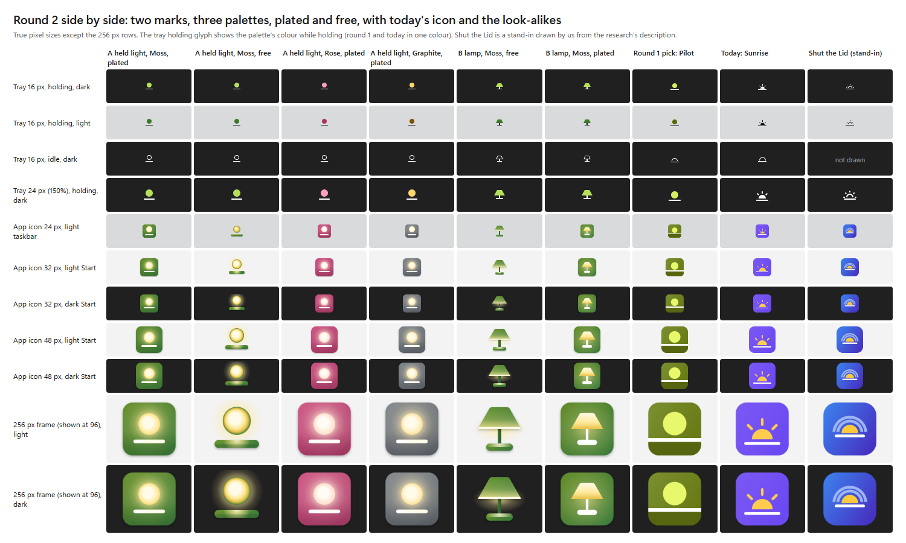

# Brand directions, round 2: the mark, then the colour

Card `docs/tasks/p6-brand-directions-2.md`, 2026-11-05. Builds on round 1 (`brand-directions.md`) and the research
reports (`brand-windows.md`, `brand-macos.md`, `brand-identity.md`, `brand-review.md`). Facts carry their source;
the rest is my judgement as the designer and says so.

## The answer in short

- **Pick: the held light, in Moss, plated on Windows.** A round light held above a line: filled while work runs, an
  empty outline when idle, struck through when off. Leaf green plate, warm lamplight that glows.
- **Runner-up: the same mark in Rose.** The second mark, the lamp, is a clear picture but a stock one, and its 16 px
  "off" glyph is the busiest of the two.
- **Plated, not free, on Windows.** Every free version fails Microsoft's own rule on light Start ("at least half of
  your icon passes a 3.0:1 contrast ratio on light and dark theme", `brand-windows.md` section 1): the held light
  keeps 3:1 on only 24 to 26% of the icon there, the lamp 35 to 47%. A light is pale; it needs something darker
  around it to glow. Plated, all three palettes pass on both Start themes (62 to 67% light, 79 to 88% dark).
- HTML board for Haik: scratch folder of the card, `board\index.html` (offline, pictures beside it).

## Step 1: the mark

### Mark A, the held light: an idle state that is not a dome

Six idle forms at 16 px, each looked at at 100% and enlarged, on both taskbars (`img/brand/dir2-marks.png`):

| Idle form | Verdict (judgement) |
|---|---|
| **The unlit light as an outline, same place** | **Kept.** Reads as the same light switched off. It is Fluent's own rule (filled is on, regular is off), which the brand review already praised in today's glyph. No dome, no bell, no eject. |
| A small low ember | At 100% a full stop over an underscore; too weak to be a state. |
| The light half set (a filled dome) | A cloche, a bell, or the eject sign: the risk the card names. |
| Round 1's empty dome | The cloche of `brand-review.md` T6. |
| The unlit light sitting on the line | The ring melts into the line: a Q or a manhole. |
| A dashed ring | Noise at 16 px; at 24 px it reads as "loading". |

The story is now the simplest one: **the light is on while work runs, off when it is done.** Nothing rises or sets,
so the mark leaves the sunrise family (Shut the Lid, `sun.horizon.fill`, `wb_twilight`). The line under the light
can be read as a terminal's cursor line; it is not needed to tell the story.

### Mark B: other lights that are not a sunrise

From `brand-identity.md` question 6 the only non-sunrise ideas not already dropped were the lit window (dropped in
round 1), the ship's wake (meaning too weak) and the night watch (the moon is the system's sleep sign). So I drew
four lights of my own at 16 px:

| Mark | Verdict (judgement) |
|---|---|
| **A table lamp** | **Kept as mark B.** The only one with its own outline at 16 px; shade filled while holding, outline when idle. Against: a lamp is a stock object (smart-home apps use it for "lights", not verified per app), and the struck "off" glyph is busy at 16 px. |
| A lantern | Handle over a box: a padlock or a handbag. |
| A light on a mast | A joystick, a pin or a microphone. |
| The light kept under a closed lid | A dot between two bars: the divide sign. |

### Both marks in the taskbar, and the vertical position

`img/brand/dir2-tray-held.png` and `img/brand/dir2-tray-lamp.png`: 16, 20, 24 and 32 px (100% to 200%) in the three
states, on dark and light taskbars rebuilt with Windows' own glyph font, and on the real dark taskbar of this laptop
at 150%.

Vertical position (`brand-review.md` T4: today's glyph sits about 2 px low). The glyphs are now drawn so the ink's
mass centre sits at 0.455 of the box, where the next app's icon sits on the real taskbar (34.9 of 72 at 150%, from
the review). Measured on the rendered taskbar (`tools\measure.py`), ours against the mean of the chevron, Wi-Fi,
volume and battery glyphs:

| Glyph | 16 px | 20 px | 24 px | 32 px |
|---|---|---|---|---|
| Held light, holding | 0.4 px higher | 0.3 higher | 0.1 higher | 0.8 higher |
| Held light, idle | 0.6 px lower | 1.2 lower | 1.1 lower | 1.2 lower |
| Lamp, holding | 0.2 px higher | 1.0 higher | 0.7 higher | 1.7 higher |
| Lamp, idle | 0.7 px lower | 0.4 lower | 0.1 lower | 0.2 higher |

The held light's idle sits about 1 px lower only because its ring is hollow and the line weighs more; the ring is
kept exactly where the lit disc is, so the light does not jump between states.

States differ by shape at 16 px (the `art.rs` test asks 25% of the ink): held light 50% (holding to idle), 36% (idle
to off), 54% (holding to off); lamp 41%, 26%, 50%.

## Step 2: the colour

Three palettes, each shown on the same mark (`img/brand/dir2-palettes.png`). Not violet or a violet-blue gradient,
not orange or near Claude's `#D97757`, not Windows blue. The light is warm in all three: the brand idea is a light
left on, so the light stays the constant and the body colour changes. Round 1's olive with lime is gone: the lime
made the tennis ball, the khaki made "army". Moss is greener (OKLCH hue 129 to 143) with a cream light.

| | Moss | Rose | Graphite |
|---|---|---|---|
| Feels like | calm, warm, alive | warm, friendly, bright | quiet, native, focused |
| Plate (120 degree ramp) | `#628C2B` to `#3E7C3B` | `#CC5282` to `#B0446E` | `#7F858C` to `#666B72` |
| The light (core, edge) | `#FFFBE8`, `#FFEA9C` | `#FFFBF5`, `#FFE6D3` | `#FFFBEA`, `#FFECB8` |
| C1, C2 plate on light / dark Start (3.0) | 3.6 to 4.6 / 3.2 to 4.1 | 3.7 to 4.9 / 3.0 to 4.0 | 3.4 to 4.8 / 3.0 to 4.4 |
| C3 light's edge on plate (3.0) | 3.3 to 4.2 | 3.4 to 4.5 | 3.2 to 4.6 |
| C4 same, worst colour-blind (3.0) | 3.1 (protan) to 3.9 | 3.1 (deutan) to 4.1 | 3.1 (protan) to 4.4 |
| C3 light's core and white bar on plate | 3.8 to 5.1 | 4.0 to 5.4 | 3.6 to 5.4 |
| C5 tray while holding, dark bar | `#B6E05A` 10.7 | `#FF9EC0` 8.5 | `#FFD66E` 11.7 |
| C5 tray while holding, light bar | `#3B7A2A` 3.7 | `#B02D60` 4.4 | `#7A5300` 4.9 |
| C7 text on page, light / dark (4.5) | 16.5 / 16.1 | 16.7 / 16.4 | 16.3 / 16.2 |
| C9 link on page, light / dark (4.5) | 5.9 / 12.0 | 6.5 / 9.7 | 6.6 / 13.1 |
| C12 dE00 from Claude orange (20), every brand colour | 32 or more | 21.8 or more | 28 or more |
| C13 nearest sampled brand, dE00 (10) | Supabase 24 | Raycast 21 | Google Gemini 17 (the sample has no greys) |
| Half rule, plated, 48 px, light / dark Start (50%) | 64% / 88% | 67% / 79% | 62% / 80% |
| Half rule, free, 48 px | **24%** / 95% | **26%** / 91% | **26%** / 93% |

Numbers from `tools\checks2.py` (round 1's colour script: WCAG 2.2 ratios, CIEDE2000, Machado 2009 at full
strength); the full tables are in the scratch folder, `out\checks.md`. Every palette now passes every check; the
tightest is the light's edge on the plate's light end under protan simulation (3.1 in Moss and Graphite).

Why Moss (judgement): the hue band 100 to 150 is the emptiest among AI and developer brands (`brand-identity.md`
question 4: none at yellow-green); far from Claude; green is the colour of "on" in status lights, so the holding
colour means what it says; and a warm light glows best against a cool green. Rose is warm and new but sits nearest
Raycast's red and reads more playful; its light glows less against a warm plate. Graphite is the most Windows-like
(Settings, Terminal and Calculator are grey) but its colour says nothing: the brand would live in the light alone.

## The Windows app icon: plated and free, with 2026 craft

`img/brand/dir2-icon-moss.png` (the pick) and `img/brand/dir2-icon-rose.png` (the other palette): 256 px and true
16, 24, 32, 48 px, plated and free, in a Start grid and on the taskbar, light and dark, beside Windows 11 style
stand-ins.

What changed from round 1's flat plate (design choices, judgement):

- **The light is emissive:** near white in the middle, the light colour only at its edge, with a soft bloom round it
  from 32 px up. It reads as a lit light, not a ball or a flag.
- **The plate is lit by the light:** a radial glow round the light, a 120 degree analogous ramp (Microsoft's 2025
  "richer and more vibrant" gradients, `brand-windows.md` section 2), and a soft vignette at the bottom. No ground band:
  with one, the plate became a sun over a field, the sunrise again.
- **Gentle depth:** a soft drop shadow under the plate (32 px up), none at 24 px and below (Microsoft's old rule: no
  shadows at 24 px or smaller).
- **Per-size drawings:** 16 and 24 px are simpler drawings of the same mark (flat gradients, no glow), as Microsoft's
  own small frames are.
- **The free version** is a light above a solid bar: the bar is the brand colour with the light falling on its top;
  the light has a narrow rim in the brand colour so its edge shows on light Start. It still fails the half rule
  there, and at 32 px in Start it is a small pale ball (see the Start row). Not glass: a lit object, flat layers.

Plated or free (judgement on the numbers above): **plated.** Microsoft prefers a transparent icon but allows a plate
("If your app's branding requires your icon be plated on a background, that's okay too"); a light needs dark round
it to glow, and the plate is also what keeps the one-PNG notice header readable on both notice themes
(`brand-windows.md` section 6). Change it when Microsoft's light-theme Start shows the free icon well in a real
screen test, or when an MSIX package lets us ship light and dark `altform` icons.

## The Mac

`img/brand/dir2-mac.png`: the held light in Moss as a Liquid Glass mockup (default, dark, clear, tinted) at 128, 64
and 32 pt, its three layers back to front (background with the glow, the bar, the light as its own layer), and the
menu bar glyph as a one-colour template, light and dark. The light is the layer the system lifts and lights as glass.
In clear and tinted the colours drop out and the shape still reads (`brand-macos.md` rule 5).

## Checked at 100%: what I fixed

Every 16 px glyph and every true-size icon was looked at at 100% and enlarged (scratch `out\look\*.png`):

- Held light off: the slash started outside the ring and ran below the line; now it runs from the light's top left
  to the line's right end, inside the glyph's box (T7).
- Lamp idle at 16 and 20 px: the anti-aliased sloped sides came out as faint grey pixels on the light taskbar; now a
  pixel staircase (one step every two rows), solid.
- Vertical position: set and measured (table above); round 1 sat about 2 px low.
- Free light, first draft: a wide green rim made it a tennis ball; now a narrow rim.
- Plated light, first draft: a flat gradient ball with a ring at its edge; now emissive with a bloom, no ring.
- Plated scene: the darker ground band turned it into a sunrise landscape; removed for a soft vignette.
- Half rule: Moss and Graphite plated were at 44 to 46% on light Start; the plates moved into the band that passes
  both Start themes and the glow is kept modest below 64 px. Now 62 to 67%.
- Light's edge on the plate: Moss 2.98 and Graphite 2.74 at the plate's light end; the light was made a little paler
  and both plates' top left one step deeper. Now 3.3 and 3.2 (3.1 under protan).
- Rose's light was peach (`#F7B596`, dE00 16 from Claude's orange); now a paler cream peach (22 or more).
- Lamp free: the light cone was a dirty brown block on dark Start; now a soft glow under the shade.
- Mac mockup: the first outline was a pillow, not Apple's shape; now a superellipse.

## Recommendation

### Pick and runner-up

**Pick: the held light, Moss, plated.** In order: (1) the sharpest 16 px glyph of the two, with three states that
differ by shape, and no dome; (2) it leaves the sunrise family that Shut the Lid owns on the Mac; (3) Moss is the most
open hue, far from Claude, and its holding colour means "on"; (4) plated, the light glows and every contrast rule
passes on both Start themes; (5) it splits into three clean Mac layers.

**Runner-up: the held light in Rose, plated,** if Haik wants warmer and brighter. **The lamp** is the second mark if
the held light fails the people test below.

Change the pick when two of three people shown the 16 px tray read the filled disc as a ball, a moon or a record
dot, or the outline as anything but "off": then the lamp.

### Haik's decisions

1. **The mark: the held light or the lamp.** Default: the held light.
2. **The colour: Moss, Rose or Graphite.** Default: Moss.
3. **Windows app icon: plated or free.** Default: plated.
4. **Tray while holding: the light in the brand colour, or one colour always.** Default: brand colour while holding
   (Moss: `#B6E05A` on a dark taskbar, `#3B7A2A` on a light one); high contrast stays one colour.
5. **A five-minute check with two or three people at 16 px before the apply card.** Default: yes.

Unchanged from round 1 and not asked again: the menu keeps Windows' glyphs with the clock for Keep awake; the
wordmark font is Instrument Sans SemiBold (round 1 decision 4).

### What applying the pick changes (round 1's list, updated)

| Where | Change |
|---|---|
| `crates/wakeshot-windows/src/tray/art.rs` | `tray_mask`: holding a disc over a line, idle the same disc as an outline, off the outline struck inside its box; ink centred at about 0.455 of the box (1 to 2 px higher than today); `app_icon`: Moss plate, emissive light with a radial glow, white bar, vignette; 16 and 24 px drawn flat, 32 px up with glow and shadow; frames up to 256 (PNG). `art.rs` has no radial gradient or blur today: either add a radial fill and one soft blur pass, or draw the frames from SVG in a build step (a choice for the apply card). Golden tests and the shape test redone. |
| Tray icon set-up | Holding colour from the theme: `#B6E05A` dark, `#3B7A2A` light, one colour in high contrast |
| `crates/wakeshot-windows/src/notify.rs` | Notice header PNG and balloon icon from the new icon; check both notice themes |
| `assets/` | `wakeshot.ico`, `wakeshot-notice.png` regenerated |
| `site/` | `wakeshot.svg`, `favicon.ico`, colours (`#628C2B` to `#3E7C3B`, light `#FFEA9C`, link `#33701F` light and `#B6E05A` dark, pages `#FBFCF7` and `#121610`) |
| `media/` | New colours and mark; the loop becomes the light fading on and off (no rising) |
| README | Loop GIFs and the social card |
| `docs/brand.md` | Rewritten: the idea, colours, tray, app icon, Mac rules |
| Mac (later) | A `.icon` in Icon Composer from three SVG layers: background, bar, light |

Size estimate for the apply card: about 150K to 200K tokens for one worker, plus a `p6-media` rerun.

## Where I disagree with the card's art direction

1. **"Free shapes, as Microsoft prefers": partly.** The glow, soft depth, lit surfaces and richer gradients are done.
   But the free version fails Microsoft's own half rule on light Start in every palette (24 to 26%), because a light
   is pale ("Yellow will never pass ... until it's brown", `brand-windows.md`). I recommend the plate, crafted, not
   the free shape. Both are drawn so Haik can see it.
2. Flag read of round 1's Pilot: agreed. Fixed by the glow and the bar; I also removed the ground band, which made a
   sunrise landscape.
3. The dome: agreed. Idle is now the outline light. "The light half set" from the card's examples was drawn and
   fails (cloche, eject).
4. Daybreak and Braces: agreed; neither continues.
5. What works and must stay: kept (per-pixel 16 px glyphs, the held light's crisp holding glyph, the side-by-side
   test, the contrast script).
6. Olive: not kept as such. Round 1's olive with lime moved to a greener moss with a cream light; the lime was what
   made it drab.

## Not verified

- How people read the 16 px glyphs (decision 5 tests it).
- The Liquid Glass looks are drawn in a page, not made in Icon Composer.
- The light taskbar and the 100%, 125% and 200% taskbars are rebuilt with Windows' glyph font; only the dark 150%
  crop is real. No live Start, taskbar or notice was seen (offline renders only).
- Whether smart-home apps use a lamp as their sign (judgement only).
- Shut the Lid and the Windows neighbours are stand-ins we drew.

## How the pictures are made

Scratch folder of the card, `tools\`: `marks2.py` (tray glyphs per pixel, round 1's rasterizer), `icons2.py` (app
icons as SVG per size), `pal2.py` (palettes), `checks2.py` (checks), `glyphs2.py` (glyph PNGs), `pages2.py` (pages),
`render_icons.ps1` and `render2.ps1` (headless Edge at device scale 1), `measure.py` (vertical position). Board:
`board\index.html` with `board\img\`. Pictures in the repo: `docs/research/img/brand/dir2-*.png`.
