# Brand directions: three drawn options, and a pick

Card `docs/tasks/p6-brand-directions.md`, Parts B and C, 2026-11-05. Part A (the review of today's UI) is
`docs/research/brand-review.md`. Built on `brand-identity.md`, `brand-windows.md` and `brand-macos.md`.

Every picture below is a render at true pixel size, made by code that can be rerun (scratch folder of the card:
`tools\assets.py` draws the icons and glyphs with a Python port of `art.rs`'s method, `tools\pages.py` lays out the
pages, `tools\render.ps1` shoots them with headless Edge at device scale 1). Zoomed views say so and use nearest
neighbour scaling. Facts carry their source; the rest is my judgement as the designer and says so.

## The answer in short

- **Pick: Pilot.** One round light held above a horizon line, on an olive plate, the light in lime. The cleanest
  16 px glyph of all, three states that differ by shape, a hue no AI or developer brand in the sample uses, every
  contrast check passed, and a motion that is the product (the light rises while work runs, sets when done).
- **Runner-up: Daybreak.** The Sunrise kept, with a terminal prompt `>` beside it, on a dawn rose plate. The smallest
  step from Haik's 2026-11-04 choice, but it is still the stock sunrise glyph plus one feature, and at 16 px it is
  the busiest of the three.
- **Third: Braces.** A light inside code braces `{ }`, on a near-black plate. The most distinct from every stand-in,
  but it reads as a code tool before a keep-awake tool, and its dark plate fails Microsoft's 3:1 rule on dark Start.
- One comparison board shows all three beside today's icon and the look-alikes: `img/brand/dir-compare.png`.

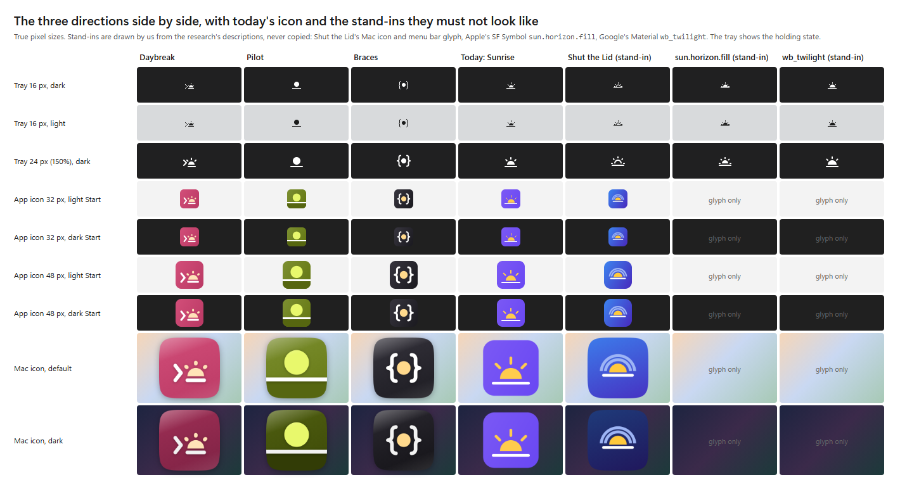

## How the three were chosen

A sketch round drew ten marks at 16, 20, 24 and 32 px on both taskbars, with the same per-pixel method as the shipped
tray art (`img/brand/dir-sketch.png`). Looked at at 100%:

| Mark | Source | Kept? | Why |
|---|---|---|---|
| Sun from a prompt | identity idea 2 (its first) | Kept: **Daybreak** | Ownable feature next to the approved sunrise |
| Held light (a disc above a line) | identity ideas 4 and 10 | Kept: **Pilot** | The crispest 16 px glyph; the state is the mark |
| Curly braces with a light | identity idea 4 with a container (mine) | Kept: **Braces** | The only shape unlike every sunrise |
| Lit window, square and arched | identity idea 3 (its second) | Dropped | Read as a monitor, a stop button or a tombstone; a square outline, which the tray guide warns against ("Prefer icons with unique outlines over square or rectangular shaped icons", `brand-windows.md` section 3) |
| Two-pane window | idea 3 variant | Dropped | Reads as a split-view or pause sign |
| Pilot ring (a dot in a ring) | idea 4 as written | Dropped | Reads as record or a radio button, as the identity report feared |
| Square brackets with a light | mine | Dropped | A frame: with the name "Wakeshot" it reads as a screenshot or record tool, the risk the identity report names |

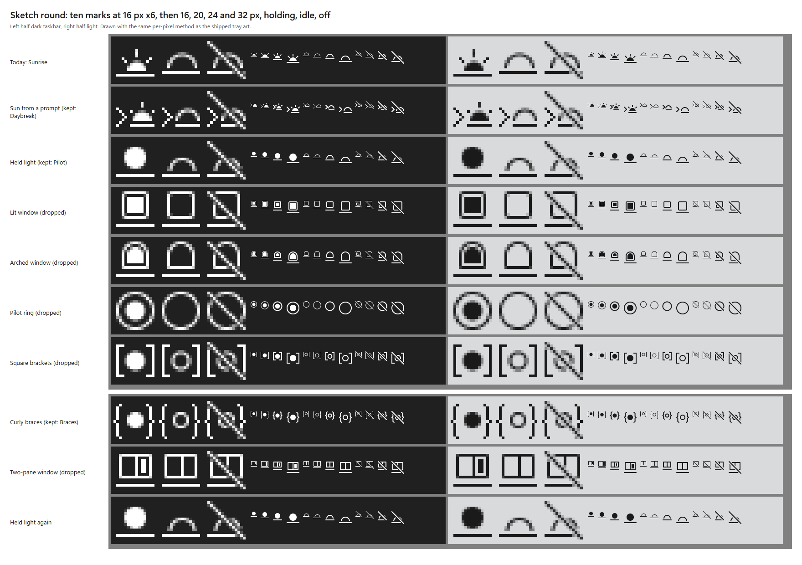

Colours: one per direction, each in a space the identity report found open or calm (its question 4): dawn rose
(magenta-rose space, its second), olive (its first), and night ink with one warm light (its third, "the calmest
look"). Violet is gone from all three: it is the 2026 "AI purple" and a near twin of Qwen and Proton.

## The three directions

Each direction has six pictures: mark and palette, Windows app icon, tray glyph, menu, Mac twin, wordmark with
favicon, plus a GitHub social card at 1280 x 640 (GitHub asks for at least 640 x 320, 1280 x 640 for best display,
under 1 MB; `brand-identity.md` section 1).

Shared rules in all three (from the research):

- The tray glyph is the mark without its plate, one colour, three states by shape (`brand-windows.md` sections 3
  and 4). Each is shown both ways: one colour in every state, and "colour only while holding", the Windows research's
  pick. The colour is a light tone on the dark taskbar and a deep tone on the light one; high contrast stays one
  colour.
- Windows: a plate (rounded square, art.rs's margin and 3/16 corner), a 120 degree ramp, flat parts. Mac: the same
  parts as full-bleed flat layers; the system cuts the corners and adds the glass. No glass on Windows.
- Small icons are drawn per size: 16 px by hand, 20 and 24 px from the tray drawing, 32 px and up from the vector
  mark. The ICO gets a 256 px frame (Part A blocker B1).
- The menu keeps Windows' look and the clock E823 for Keep awake in all three: no direction made a better case,
  and the menu carries no brand colour (`brand-windows.md` section 5, `brand-macos.md` rule 14).
- Wordmark: Instrument Sans SemiBold (SIL Open Font License), per `brand-identity.md` section 7. It held up in the
  lockup and the social card, so its "change it when" (looks cramped) did not trigger.

### Daybreak: the sun rises from a prompt

The Sunrise with a terminal prompt `>` before it, the horizon as the prompt's underscore: your terminal raises the
sun. Dawn rose plate, white prompt, cream sun. In motion the cursor blinks, then the sun rises.

| Picture | File |
|---|---|
| Mark and palette | 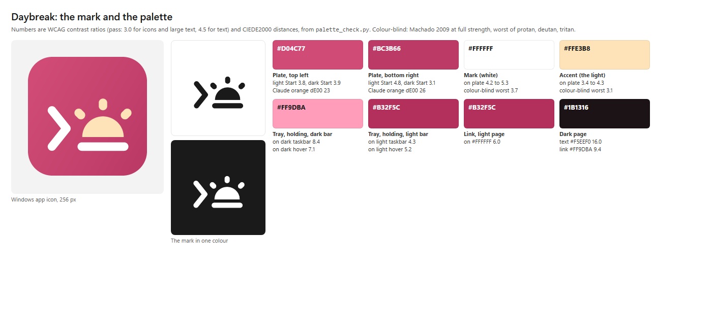 |
| Windows app icon | 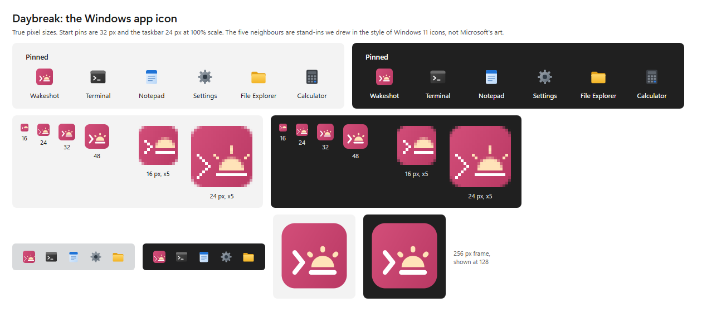 |
| Tray glyph | 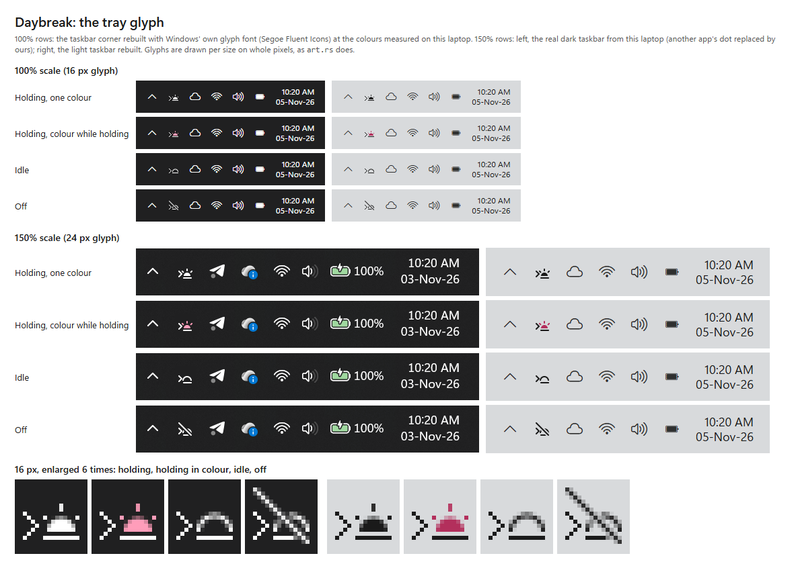 |
| Menu | 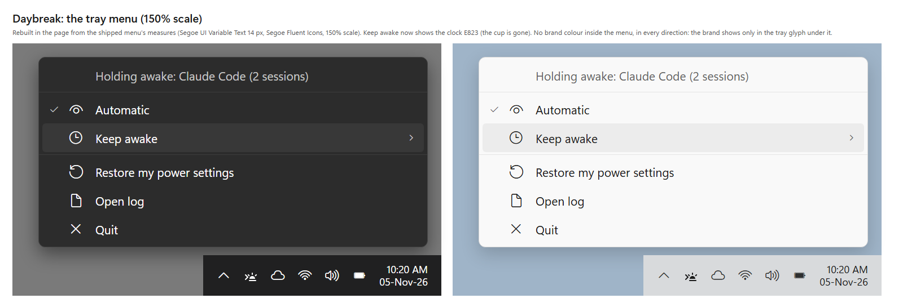 |
| Mac twin | 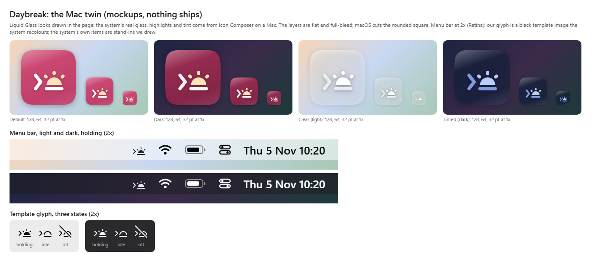 |
| Wordmark, lockup, favicon | 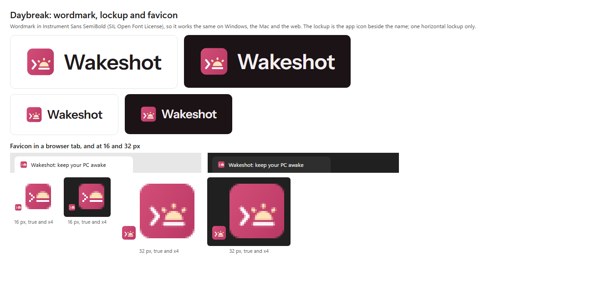 |
| GitHub social card | 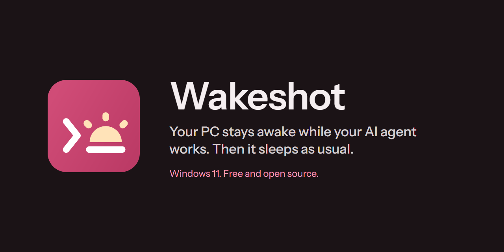 |

For: keeps the approved story and the three tray states; the prompt is a feature `sun.horizon.fill`, `wb_twilight`
and Shut the Lid do not have (`brand-macos.md` rule 7); the warmest of the three; every check passes.
Against: without the prompt it is the stock glyph again, and at 16 px the prompt is 4 px wide; the busiest tray
glyph (the off state is crowded); the half sun with rays keeps today's "cloche or siren" risk (Part A, T6); rose sits
near Raycast's red (dE00 18.7) and GraphQL's magenta, and can read playful.

### Pilot: one light, held above the line

A round light held up above a horizon while work runs; idle, the light has set (an empty half disc on the line); off,
struck through. On Windows and the Mac the icon is a scene: the horizon crosses the whole plate, the ground below is a
shade darker. Olive plate, white line, lime light.

| Picture | File |
|---|---|
| Mark and palette | 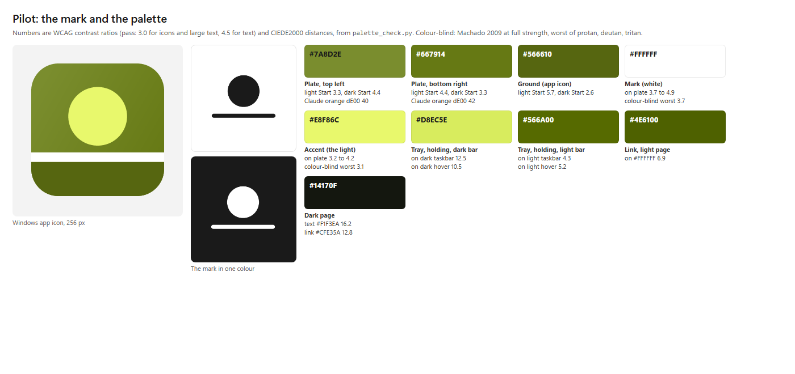 |
| Windows app icon | 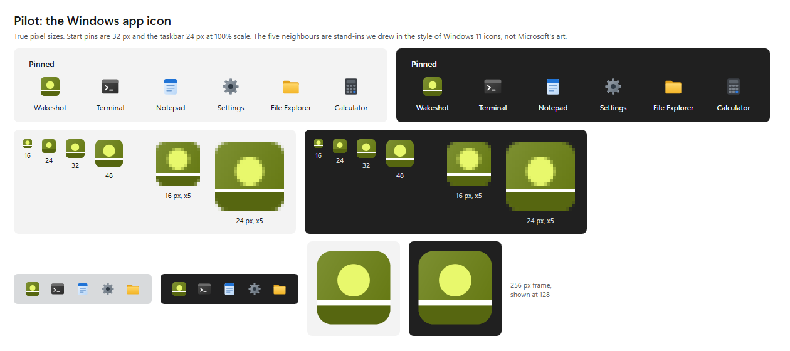 |
| Tray glyph | 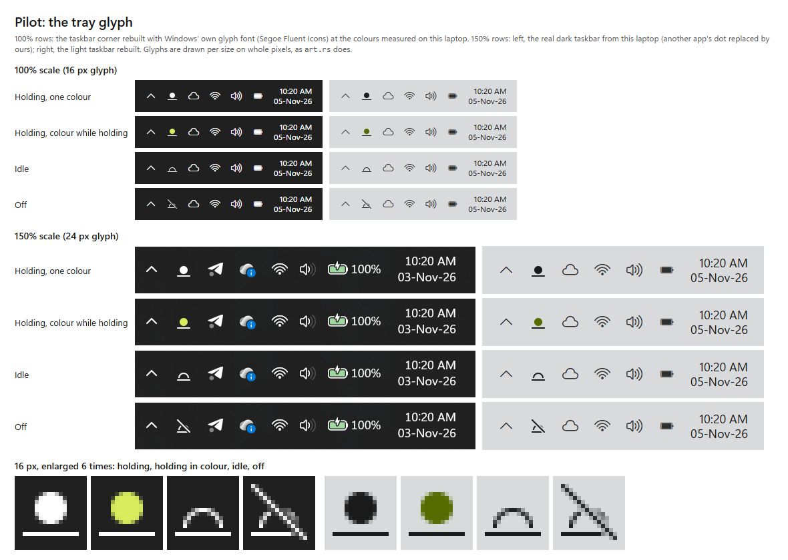 |
| Menu |  |
| Mac twin | 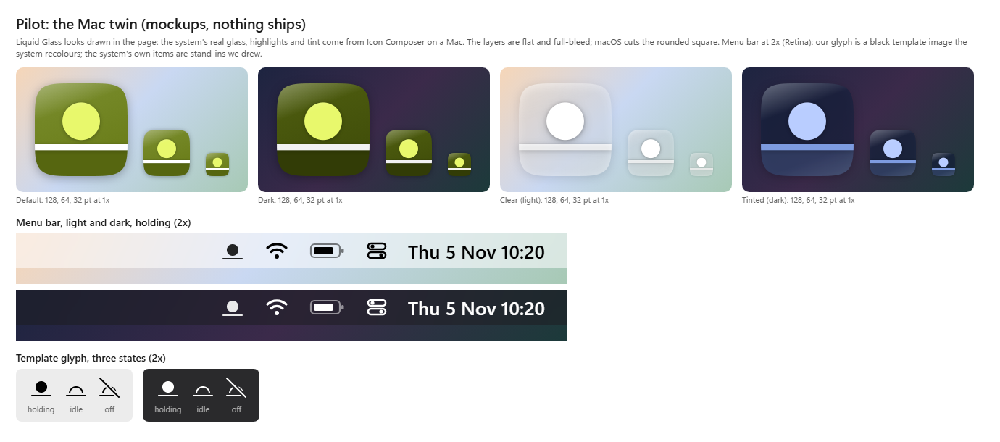 |
| Wordmark, lockup, favicon | 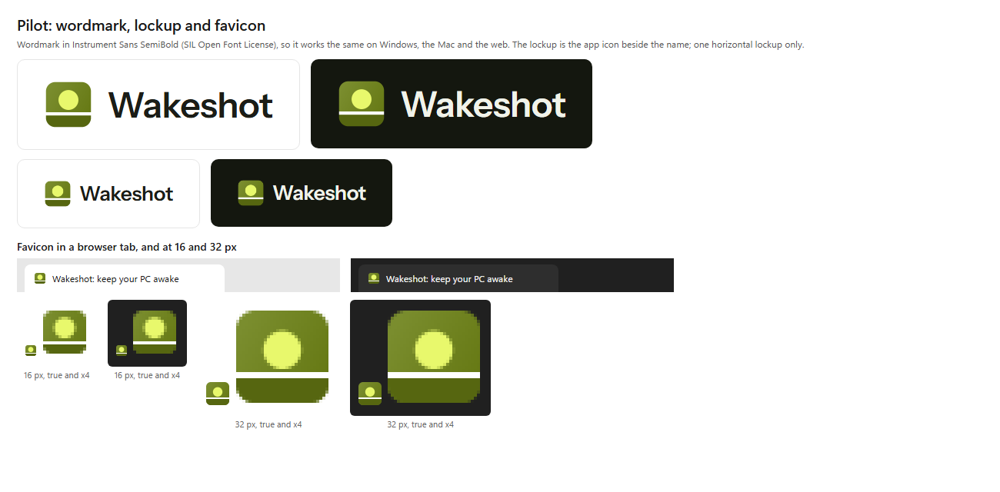 |
| GitHub social card | 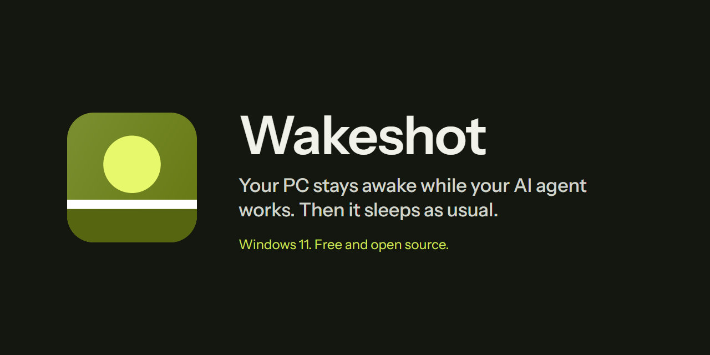 |

For: two closed shapes, so it is the sharpest glyph at 16 px and the boldest at 1024 (Apple's "bold, no hairlines");
the three states differ in 55 to 75% of their ink at 16 px (the `art.rs` test asks 25%); no rays, a full disc and no
gold, so it is far from the three stand-ins; olive is the emptiest hue among AI and developer brands (nearest in the
sample: Supabase at dE00 27.6) and far from Claude's orange (dE00 40 to 48); it splits into three Mac layers (ground,
line, light) and its mono look is a white disc over a white line.
Against: the mark is very simple, so it is owned by the configuration (the gap, the full disc, the plate scene), not
by a detail; olive can read as "army" or "khaki", and the lime light as a tennis ball or a moon (the first, paler
tint did read as a moon and was changed); a light over a horizon is still the sunrise family, so next to Shut the
Lid on a Mac the two are cousins, not twins.

### Braces: a light held in a code block

The light sits inside curly braces: your code holds the light on. Idle, the braces are empty; off, struck through.
Near-black plate, white braces, warm light.

| Picture | File |
|---|---|
| Mark and palette | 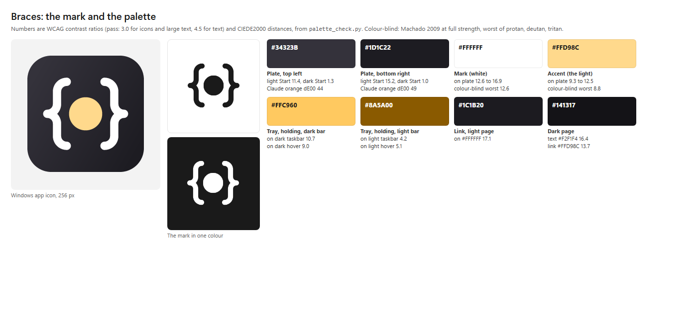 |
| Windows app icon | 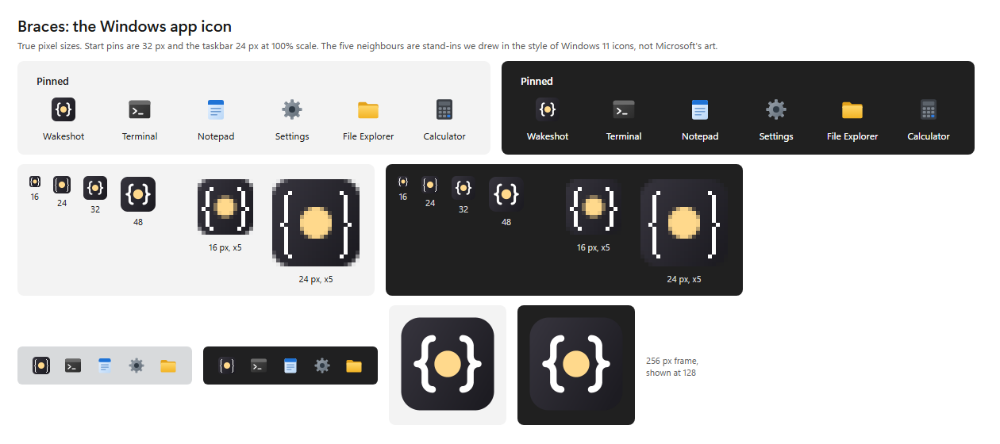 |
| Tray glyph | 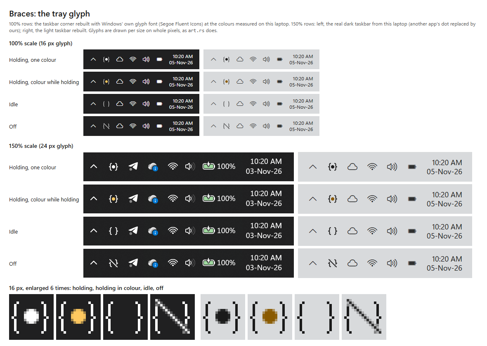 |
| Menu |  |
| Mac twin | 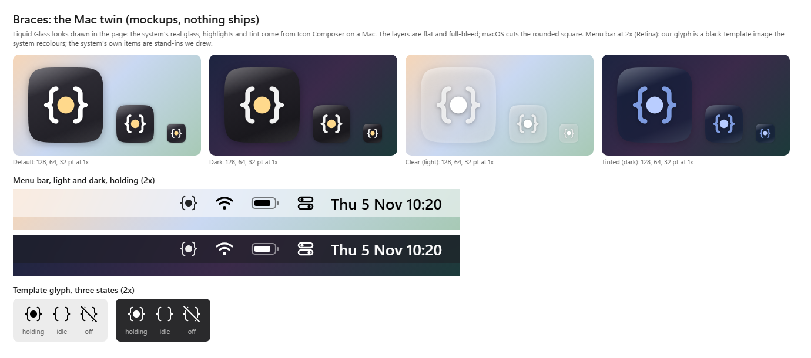 |
| Wordmark, lockup, favicon | 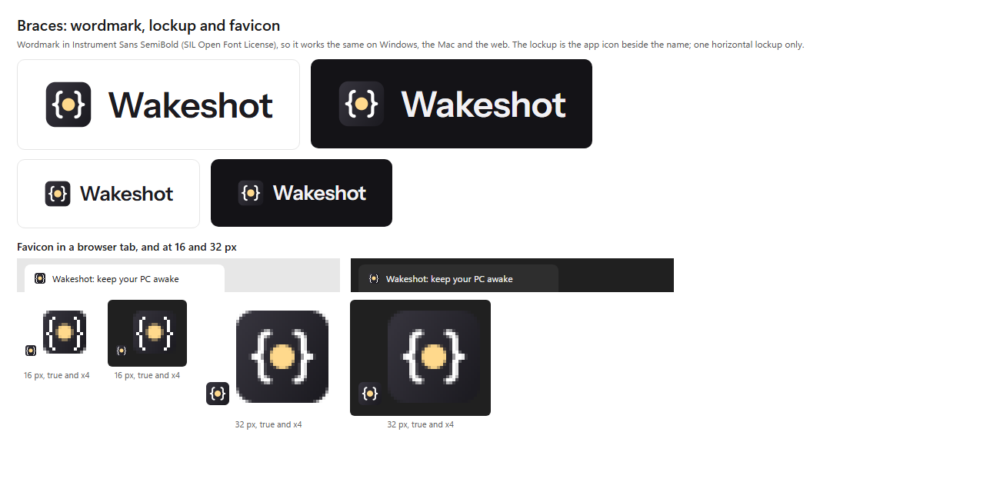 |
| GitHub social card | 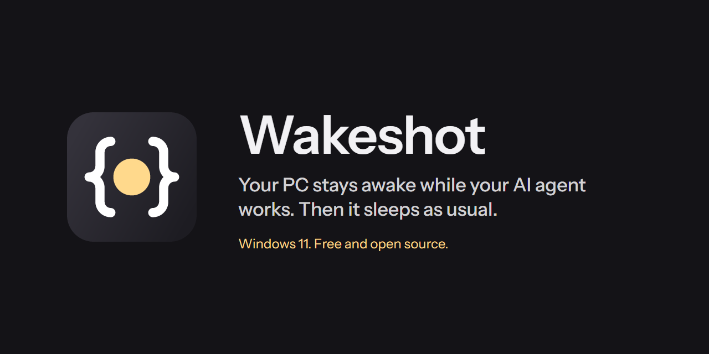 |

For: unlike every sunrise, weather sign and keep-awake icon in the research; crisp at 16 px; the quiet "dark with one
light" look the big brands moved to in 2026; says "for developers" at once.
Against: it says "code tool" (a JSON viewer, an editor plug-in) before "keeps my PC awake"; braces are a stock code
sign (Material's `data_object`), so only the light inside is ours; the dark plate fails Microsoft's 3:1 rule on dark
Start (1.0 to 1.3; only 18% of the 48 px icon keeps 3:1 there, Microsoft asks at least half); near-black is the
colour of Cursor, Vercel, Ollama and GitHub Copilot, so the colour adds nothing; the warm light on near-black is
Adrafinil's palette on the Mac (`brand-macos.md` section 6).

## Contrast numbers

From `tools\palette_check.py` (the check list of `brand-identity.md` question 8; WCAG 2.2 ratios, CIEDE2000, Machado
2009 colour-blind matrices at full strength). Plate checks run at both ramp ends and the middle.

| Check | Daybreak | Pilot | Braces |
|---|---|---|---|
| Plate | `#D04C77` to `#BC3B66` | `#7A8D2E` to `#667914` | `#34323B` to `#1D1C22` |
| C1 plate on light Start `#F3F3F3` (3.0) | 3.8 to 4.8 | 3.3 to 4.4 | 11.4 to 15.2 |
| C2 plate on dark Start `#202020` (3.0) | 3.1 to 3.9 | 3.3 to 4.4 | **1.0 to 1.3, fail** |
| Share of the 48 px icon keeping 3:1, light / dark Start (Microsoft: at least half) | 85% / 100% | 77% / 74% | 83% / **18%** |
| C3 white mark on plate (3.0) | 4.2 to 5.3 | 3.7 to 4.9 | 12.6 to 16.9 |
| C3 accent on plate (3.0) | `#FFE3B8` 3.4 to 4.3 | `#E8F86C` 3.2 to 4.2 | `#FFD98C` 8.8 to 11.8 |
| C4 same, worst colour-blind (3.0) | mark 3.7, accent 3.1 | mark 3.7, accent 3.1 | mark 12.6, accent 8.8 |
| C5 tray colour, dark bar and hover (3.0) | `#FF9DBA` 8.4, 7.1 | `#D8EC5E` 12.5, 10.5 | `#FFC960` 10.7, 9.0 |
| C5 tray colour, light bar and hover (3.0) | `#B32F5C` 4.3, 5.2 | `#566A00` 4.3, 5.2 | `#8A5A00` 4.2, 5.1 |
| C6 states differ at 16 px (art.rs test: 25% of ink) | 45 to 72% | 55 to 75% | 42 to 61% |
| C7 text on page, light / dark (4.5) | 17.2 / 16.0 | 17.0 / 16.2 | 17.1 / 16.4 |
| C9 link on page, light / dark (4.5) | 6.0 / 9.4 | 6.9 / 12.8 | 17.1 (ink, underlined) / 13.7 |
| C12 dE00 from Claude orange (20) | 22.8 to 29.8 | 40.2 to 48.5 | 25.8 to 48.7 |
| C13 nearest sampled brand, dE00 (10) | Raycast 18.7 | Supabase 27.6 | Zed 30.5 among coloured brands; black brands are near |

Pilot's darker ground band (`#566610`) is 2.6 on dark Start; it is a quarter of the icon, and the whole icon keeps
74% on dark Start. Braces' only fix within the rule is a mid-grey plate (`#6F757B`: 4.2 on light Start, 3.5 on dark), which loses
the night look; an unpackaged app cannot ship a separate dark-theme ICO (`brand-windows.md` section 1).

## Checked at 100%: what I fixed

Every 16 px tray render was looked at at 100% and zoomed (`out\review*.png`, `out\c*.png` in the scratch folder):

- Braces idle was a ring in place of the light: only 21% of the ink differed from holding at 16 px, under the 25% the
  `art.rs` shape test asks. Idle is now empty braces (55%).
- Pilot's app icon first read as a profile picture (a disc over a short bar on a square). Tried four fixes (low,
  off-centre, cut by the line, touching); kept a horizon that crosses the whole plate with darker ground below, which
  turns it into a scene. The free mark got a thin horizon twice the light's width for the same reason.
- Pilot's light was a pale lime that read as a moon (the sleep sign). A saturated lime then failed the colour-blind\n  check on the light end of the plate (2.96, protan); the light is now #E8F86C (3.1).
- Daybreak's 16 px app icon from the grid lost the prompt (a 12 px mark box) and put a sun pixel against the
  chevron; it is now drawn by hand at 16 px; 20 and 24 px reuse the tray drawing.
- Shut the Lid's stand-in glyph was scaled from 32 px and looked faint; it is now drawn at 16 and 24 px like the rest.

Not fixed (for the apply card): Part A finding T4, the glyph sits about 2 px below Windows' own; Daybreak and Pilot
keep the horizon on row 13 like today, so the apply card should lift the ink 1 px and check it on a real taskbar.

## Part C: recommendation

### Pick and runner-up

**Pick Pilot.** Reasons, in order: (1) the tray is the only surface always on screen, and Pilot's glyph is the
sharpest at 16 px in all three states (Part A's main tray finding is that today's rays break at 16 px); (2) it is the
only option that is both new and calm: no rays, no gold, no violet, so it does not sit with `wb_twilight`,
`sun.horizon.fill`, Shut the Lid or the AI purple crowd; (3) olive is the most open colour among the brands a
Wakeshot user sees, and it passes every check; (4) it keeps the story Haik liked (the light rises while work runs and
sets when done), so the README loop and the video keep their idea; (5) it is the simplest to draw in `art.rs` (a disc
and a bar) and the cleanest Liquid Glass split on the Mac.

**Runner-up Daybreak**, if Haik wants to keep the Sunrise he chose on 2026-11-04: it passes every check and fixes
the colour, but keeps most of the stock glyph.

Change the pick when people shown the 16 px tray read Pilot's glyph as anything but a light or sun (a person, a
ball, a moon), or when Haik finds olive cold or "army": then Daybreak.

### Haik's questions

**Is the current logo good?** No as a logo, yes as a tray glyph. It is crisp from 24 px and reads "wake", but it is
the stock sunrise of every icon set (Material's `wb_twilight` is nearly the same drawing, Apple has
`sun.horizon.fill`), a Mac keep-awake app (Shut the Lid) launched with the same picture on 2026-11-04, and at 16 px
its rays break up (Part A). It cannot be owned. See the stand-in columns of the comparison board.

**The colours?** Change them. The violet is the 2026 "AI purple" and a near twin of Qwen and Proton (dE00 1.5 and
1.7), and the gold sun on it fails 3:1 for protan colour-blind users. All three directions leave violet; the pick
moves to olive with one lime light, the emptiest hue in the field.

**White or black tray icon, or colour?** One colour, white on a dark taskbar and near-black on a light one, like
Windows' own glyphs, with the brand colour only while holding (the Windows research's pick: Windows itself colours
state, as the green charging battery). Each direction shows both; the colour one is the default because "holding" is
the state that costs battery and blocks sleep. High contrast stays one colour.

**Tray icon versus app icon: same or different?** Same shape, different finish. The tray glyph is the mark without
its plate and colour, in the taskbar's ink, with a state change; the app icon is the mark on its plate in colour.
Every one-colour tray app in the survey does this (OneDrive, Docker, Telegram, Claude), because the user must link
"the thing I installed" to "the thing in my tray".

**Brand mark versus icons?** One mark, four uses: the app icon (mark on its plate), the tray and menu bar glyph (mark
alone, one colour), the favicon (the app icon, small), and the lockup and social card (app icon beside the wordmark).
The menu's item glyphs are not the brand: they stay Windows' own (Segoe Fluent Icons), with the clock for Keep awake.

**The Mac icon and panel: different, glassy, Tahoe?** The same picture, Apple's finish. The Mac icon is the same
layers as flat full-bleed shapes in Apple's Icon Composer, which adds the glass, the six looks and the rounded mask
(macOS 27 Golden Gate is current; "Tahoe compliant" means Liquid Glass compliant). The Mac panel is a native menu
with the same words and order, no item icons, no brand colour: the system draws it in Liquid Glass. No glass is
copied onto Windows. Nothing ships for the Mac yet; making the real `.icon` needs one session on a Mac.

**Which 2026 trends to follow, which to skip?** Follow: bold flat marks, one accent colour on a calm base, motion
tied to the states (the light rises and sets), and a clean layer split for Apple's glass. Skip: violet and
blue-to-purple gradients (the AI look), fake glass on Windows, grain, loud gradients, 3D renders.

### Decisions only Haik can make

1. **Which direction.** Default: Pilot.
2. **Colour while holding in the tray, or one colour always.** Default: colour while holding.
3. **Keep a plate on the Windows icon, or a free shape.** Default: keep the plate (it carries the contrast on both
   Start themes and in the one-PNG notice header; Pilot's plate is a scene, as Photos' is).
4. **Wordmark font: Instrument Sans SemiBold on the page, README, social card, video and Mac; the Windows app UI
   stays Segoe UI Variable.** Default: yes.
5. **Show the sketch to two or three people at 16 px before the apply card.** Default: yes, a five-minute check with
   the tray picture (does Pilot read as a light?), since that is the pick's main risk.

### What applying the pick changes

| Where | Change |
|---|---|
| `crates/wakeshot-windows/src/tray/art.rs` | New `tray_mask` shapes (light, set light, struck); `app_icon` becomes the plate scene (ground, horizon across the plate, light); new colours; `APP_ICON_SIZES` gets 96, 128, 256 (Part A B1) with a PNG-compressed 256 frame; hand-drawn 16 px icon; a colour path for "holding"; golden tests and the shape test redone |
| `crates/wakeshot-windows/src/tray/menu_paint.rs` | No glyph change (E823 stays); a colour while holding needs no menu change |
| `crates/wakeshot-windows/src/tray/` (icon set-up) | The holding icon in colour from the theme (light tone on dark, deep tone on light, one colour in high contrast) |
| `crates/wakeshot-windows/src/notify.rs` | The notice picture comes from the new app icon (header PNG `wakeshot-notice.png` and the balloon icon); check both notice themes |
| `assets/` | `wakeshot.ico`, `wakeshot-notice.png`, regenerated from the art code |
| `site/` | `wakeshot.svg` (new mark), `favicon.ico`, colours in `style.css` (olive, lime, ink), the wordmark |
| `media/src/theme.ts`, `media/src/art/` | New colours and the mark; the loop becomes the light rising and setting |
| README pictures | The loop GIFs, the social card (`dir-pilot-social.png` as the start), repo description |
| `docs/brand.md` | Rewritten: the idea, colours, tray, app icon, wordmark, the Mac rules |

Size estimate for the apply card: about 150K to 200K tokens for one worker (art code and tests, ICO, notice icon,
site, docs), plus a separate `p6-media` rerun for the loop and video. The Mac `.icon` is later, on a Mac.

## Not verified

- How people read the 16 px glyphs (person, ball, moon, code tool): judgement only; decision 5 tests it.
- The Liquid Glass looks are drawn in the page, not made in Icon Composer (it runs only on a Mac); the real clear and
  tinted looks may differ.
- The Mac menu bar and the Windows 11 neighbours are stand-ins we drew; Shut the Lid's icon, `sun.horizon.fill` and
  `wb_twilight` are drawn from the research's descriptions, not from the real art.
- The light taskbar at 100% and 150% is rebuilt from Windows' own glyph font at the measured colours; the only real
  crop is the dark taskbar at 150%.
- No live taskbar, notice or Start menu was seen with the new icons (the session had no screen).
